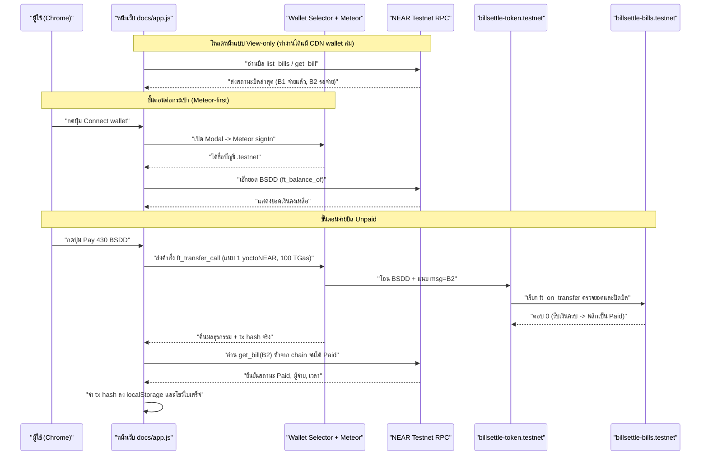

# แผนการดำเนินงาน — BillSettle Slice 4: เชื่อมกระเป๋าเงินในเบราว์เซอร์ (เน้น Meteor Wallet)

> เอกสารแผนงานสำหรับรีวิว (Issue #1: [Slice 4: in-browser wallet signing (Meteor-first)](https://github.com/Techfrontiers/billsettle/issues/1))

## ภาพรวมเป้าหมาย (Goal Description)

เพิ่มความสามารถให้ผู้เข้าชมหน้า [เดโม BillSettle](https://techfrontiers.github.io/billsettle/) (`docs/`) สามารถเชื่อมต่อกระเป๋าเงิน NEAR Testnet (**Meteor Wallet เป็นตัวหลัก**) ได้จากบนหน้าเว็บโดยตรง แล้วกดจ่ายบิลที่ยังค้างชำระ (`Unpaid`) ด้วยเหรียญ `BSDD` ผ่าน `ft_transfer_call` บน `billsettle-token.testnet` จากนั้นเช็กยืนยันสถานะบิลบนบล็อกเชนจริงด้วย `get_bill` แล้วแสดงใบเสร็จพร้อมเลขธุรกรรมจริง (`tx hash`) และลิงก์ไปยัง Explorer — โดยยังคงสถาปัตยกรรมแบบ **No-build step** (ไฟล์ HTML/JS ล้วนบน GitHub Pages ไม่ต้อง compile/bundle) และถ้ายังไม่ต่อกระเป๋า หน้าเว็บต้องทำงานแบบ **ดูอย่างเดียว (view-only)** ได้เหมือนเดิมทุกประการ

งานนี้เป็น code slice สุดท้ายก่อนส่งเข้าประกวด NEAR Hackathon: Build Beyond Boundaries — Real-World Money track (กำหนดส่ง อาทิตย์ที่ 15 พ.ย. 2026 เวลา 06:59 น. เวลาไทย)

---

## อธิบายการทำงานแบบบ้านๆ (เข้าใจง่าย ไม่ต้องรู้ศัพท์บล็อกเชน)

ลองนึกภาพตามร้านขายของชำทั่วไป:

1. **ปัญหาเดิมของร้านค้า (ทำไมต้องทำระบบนี้):**
   - ปกติร้านจะส่งบิลค่าของให้ลูกค้าทางแชทหรือจดใส่กระดาษ แล้วลูกค้าโอนเงินและส่งสลิปกลับมาในแชท
   - ปัญหาคือสลิปกับบิลอยู่คนละที่ พอเวลาผ่านไปหรือลูกค้าถามว่า *"บิลนี้จ่ายไปหรือยัง?"* ก็ต้องมานั่งไถแชทย้อนดูทีละข้อความ เถียงกันวุ่นวาย

2. **สิ่งที่เรามีอยู่แล้วตอนนี้ (Slice 1–3 เปรียบเทียบให้เห็นภาพ):**
   - ตอนนี้เรามี **สมุดบัญชีร้านค้าบนบล็อกเชน** (`billsettle-bills.testnet`) กับ **เหรียญคูปองจำลองชื่อ BSDD** (`billsettle-token.testnet` เงินปลอมสำหรับทดสอบ ไม่มีมูลค่าจริง)
   - ร้านค้าสร้างบิลเอาไว้ 2 ใบ:
     - **บิล B1** (ข้าวสาร 5 กก. + น้ำปลา = 620 BSDD) → ทดลองจ่ายผ่านคำสั่งหลังบ้านไปแล้ว สถานะตอนนี้คือ **"จ่ายแล้ว (Paid)"**
     - **บิล B2** (น้ำมันพืช + น้ำตาล = 430 BSDD) → ยังไม่ได้จ่าย สถานะเป็น **"รอจ่าย (Unpaid)"**
   - แต่หน้าเว็บ [demo](https://techfrontiers.github.io/billsettle/) ที่มีอยู่ตอนนี้ เป็นแค่ **"ป้ายประกาศหน้าร้าน"** คือดูได้อย่างเดียวว่า B1 จ่ายแล้ว, B2 ยังไม่จ่าย และสแกน QR เปิดดูหน้ารายการได้ แต่ **ยังไม่มีปุ่มให้ลูกค้าหยิบกระเป๋าตังค์มากดจ่ายบนหน้าเว็บได้จริง**

3. **สิ่งที่เราจะเพิ่มในรอบนี้ (Slice 4):**
   - **ติดปุ่ม "ต่อกระเป๋าตังค์" (Connect wallet)** ไว้บนหัวเว็บ โดยใช้ **Meteor Wallet** (กระเป๋าเงินบนเบราว์เซอร์ของ NEAR):
     - ถ้า **ยังไม่ต่อกระเป๋า:** หน้าเว็บจะเหมือนเดิมเป๊ะ ดูบิล ดู QR ดูใบเสร็จ B1 ได้ปกติ
     - ถ้า **ต่อกระเป๋าแล้ว:** หน้าเว็บจะรู้ว่าลูกค้าคือบัญชีไหน (เช่น `someone.testnet`) และโชว์ให้เห็นด้วยว่าในกระเป๋ามีเหรียญ `BSDD` เหลือกี่บาท (พอจ่ายบิลไหม)
   - **ติดปุ่ม "จ่ายบิล" บนหน้ารายการที่ยังไม่จ่าย (เช่น B2):**
     - พอลูกค้ากดปุ่มจ่าย หน้าเว็บจะเรียกหน้าต่าง **Meteor Wallet** เด้งขึ้นมาให้ลูกค้าตรวจยอดและกดยืนยันเอง (เราไม่ได้เก็บคีย์หรือรหัสผ่านของลูกค้าไว้เลย)
     - พอกดยืนยัน เหรียญ `BSDD` จำนวน 430 BSDD จะถูกโอนจากกระเป๋าลูกค้าไปที่บัญชีร้าน พร้อมแนบข้อความสั้นๆ ว่า `"จ่ายบิล B2"` (`ft_transfer_call` พร้อมค่าธรรมเนียมยืนยัน 1 yoctoNEAR ซึ่งเป็นกฎความปลอดภัยมาตรฐานของ NEAR)
   - **ทำไมระบบต้องไป "เช็กสมุดบัญชีบนเชนอีกรอบ" หลังจ่ายเสร็จ:**
     - ระบบโอนเหรียญของ NEAR มีกลไก "คืนเงินอัตโนมัติถ้าจ่ายผิด": สมมติจ่ายบิลที่คนอื่นจ่ายไปแล้ว หรือยอดไม่ตรง สมุดบัญชีร้าน (`billsettle-bills.testnet`) จะปฏิเสธและเด้งเหรียญกลับคืนให้ลูกค้า แต่ตัวเลขธุรกรรมข้างนอกอาจจะยังดูเหมือนส่งสำเร็จ (`"0"`)
     - ดังนั้น หลังลูกค้ากดจ่ายเสร็จ หน้าเว็บจะไม่เชื่อแค่ว่าป๊อปอัปปิดลงแล้ว แต่จะ **วิ่งไปถามสมุดบัญชีร้าน (`get_bill`) อีกรอบจริงๆ** จนมั่นใจว่าสถานะเปลี่ยนเป็น **"Paid"** แล้วจริงๆ ถึงจะยอมพลิกหน้าบิลเป็น "จ่ายแล้ว" และออกใบเสร็จให้
   - **ทำไมต้องเก็บเลขสลิป (tx hash) ไว้ในเบราว์เซอร์ (`localStorage`):**
     - ข้อจำกัดของสมุดบัญชีบนบล็อกเชน (`contract/src/lib.rs`) คือตัวสมุดบัญชีรู้แค่ว่า *"ใครจ่าย + จ่ายกี่บาท + จ่ายตอนกี่โมง"* แต่มันอ่าน **"เลขที่อ้างอิงสลิป (tx hash)"** ของตัวเองไม่ได้
     - มีแค่ตอนที่ลูกค้ากดโอนผ่านหน้าเว็บเท่านั้นที่หน้าเว็บจะได้รับเลขสลิปจริงกลับมา เราจึงเอาเลขสลิปจริงนี้โชว์เป็นลิงก์ใบเสร็จ และบันทึกจำไว้ในเบราว์เซอร์ของผู้จ่ายด้วย เพื่อว่าเวลาลูกค้ากดรีเฟรชหน้า (`F5`) เลขสลิปจริงจะได้ยังอยู่ ไม่หายไป

---

## สถานะปัจจุบันที่ตรวจสอบยืนยันแล้ว (Verified State)

- **Smart Contracts บน NEAR Testnet (Deploy แล้ว ไม่ต้องแก้ไขสัญญา):**
  - สัญญาบิล: `billsettle-bills.testnet` (`list_bills`, `get_bill`, `create_bill`, `ft_on_transfer`)
  - สัญญาเหรียญจำลอง: `billsettle-token.testnet` (`BSDD`, 6 ทศนิยม, มาตรฐาน NEP-141) — บัญชี `billsettle-bills.testnet` ลงทะเบียน storage บน token เรียบร้อยแล้ว (`total: 1250000000000000000000`)
  - ข้อมูลบิลล่าสุดที่เช็กจาก `https://rpc.testnet.near.org`:
    - `B1`: `Paid`, ยอด `"620000000"` (`620 BSDD`), ผู้จ่าย `billsettle-customer.testnet`, tx `9fxsLpNoP1LFPwMMnjZjdqWqZejvtxB3AJxocZDXr9ge` (ใช้ `gas: 100000000000000`, `deposit: "1"`)
    - `B2`: `Unpaid`, ยอด `"430000000"` (`430 BSDD`)
- **Frontend (`docs/index.html`, `docs/app.js`):**
  - เป็น HTML + CSS + Vanilla JS ไม่มี build step (ตอนนี้ใช้ไลบรารีภายนอกแค่ `qrcodejs@1.0.0`)
  - ดึงข้อมูลผ่าน `rpcView` และเก็บ `KNOWN_RECEIPTS.B1` ไว้สำหรับใบเสร็จ B1

---

## จุดสำคัญที่ตรวจสอบพบจากโค้ดจริง (Technical Findings & Risk Mitigations)

### 1. ข้อควรระวังสำคัญของ `@near-wallet-selector` เวอร์ชัน 10.1.4 (Action Format)
จากการตรวจสอบซอร์สโค้ดจริงของ `@near-wallet-selector/core@10.1.4` และ `@near-wallet-selector/meteor-wallet@10.1.4` พบว่า:
- `core` v10 (`decorateWallet`) **ไม่ได้แปลง** action รูปแบบเก่า `{ type: "FunctionCall", params: ... }` ให้อัตโนมัติอีกต่อไป
- `meteor-wallet` v10.1.4 จะเรียก `najActionToInternal(action)` ตรงๆ ซึ่งจะ throw `Error("Unsupported NAJ action")` ทันที หากไม่ได้ส่งมาเป็น `@near-js/transactions` NAJ `Action`
- **แนวทางแก้:** ต้องแปลง action ด้วย `internalActionToNaj(...)` ที่ export มาจาก `@near-wallet-selector/core@10.1.4` ก่อนส่งให้ `wallet.signAndSendTransaction`

### 2. พฤติกรรมของ `ft_transfer_call` กรณีจ่ายไม่ผ่าน (`ft_resolve_transfer`)
ตามโค้ดใน `token/src/lib.rs`:
- หาก `billsettle-bills.testnet::ft_on_transfer` panic (เช่น บิลถูกจ่ายไปแล้ว หรือยอดไม่ตรง) ฟังก์ชัน `ft_resolve_transfer` จะจับ error, คืนเหรียญให้ผู้ส่ง, และจบธุรกรรมด้วย `SuccessValue: "0"` โดยไม่เกิด Transaction Failure ชั้นนอก
- **แนวทางแก้:** หลัง `signAndSendTransaction` คืนค่ากลับมา หน้าเว็บต้องตรวจผล `outcome.status` และ `outcome.receipts_outcome` **และ** เรียก `get_bill` จาก chain ซ้ำเพื่อยืนยันว่า `status === "Paid"` จริงเท่านั้น จึงจะบันทึก tx hash และแสดงหน้าใบเสร็จ (ห้ามพลิกสถานะจาก local state หรือสร้างใบเสร็จปลอมเด็ดขาด)

### 3. ความปลอดภัยของการโหลด ESM ผ่าน CDN แบบ No-Build-Step
ตรวจสอบไฟล์ ESM bundle จาก `cdn.jsdelivr.net` เวอร์ชัน `@10.1.4` (`core`, `meteor-wallet`, `modal-ui`, `@meteorwallet/sdk@1.0.24`, `@near-js/*`, `near-api-js@6.2.6`) แล้ว:
- ไม่มี `require()`, `process.env`, หรือ `Buffer.from` ที่ขาด polyfill
- ใช้ dynamic `import()` ภายใน `app.js` เพื่อให้หน้าเว็บโหลดข้อมูลบิลแบบ view-only ขึ้นทันทีโดยไม่ต้องรอโหลดโมดูลกระเป๋าเงิน และยังทำงานได้สมบูรณ์แม้ CDN ของกระเป๋าเงินโหลดไม่สำเร็จ

### 4. การเปลี่ยนสถานะถาวรของบิล `B2` บน Testnet
- หากทดสอบจ่ายบิล `B2` (`430 BSDD`) สำเร็จบน `billsettle-bills.testnet` แล้ว สถานะของ `B2` จะกลายเป็น `Paid` ถาวร (สัญญาห้ามจ่ายซ้ำ) จึงต้องตัดสินใจร่วมกันว่าจะทดสอบจ่าย `B2` เลย (แล้วให้ `billsettle-shop.testnet` สร้าง `B3` ไว้โชว์ในวิดีโอ/ให้กรรมการกด) หรือสร้างบิลทดสอบแยกมาก่อน

---

## คำถามที่ต้องยืนยันก่อนลงมือ (Open Questions for Review)

1. **บิลที่จะใช้ทดสอบจ่ายจริงบน Testnet (`B2` vs บิลทดสอบใหม่):** ตอนทดสอบจริงใน Chrome อยากกดจ่าย **B2** เลย (แล้วค่อยใช้บัญชีร้าน `billsettle-shop.testnet` สร้างบิล `B3` ไว้ให้กรรมการ/วิดีโอเดโม) หรืออยากให้สร้างบิลทดสอบแยก (เช่น `B-TEST`) มาลองจ่ายก่อนเพื่อเก็บ `B2` ไว้รอตอนอัดวิดีโอ?
2. **ตัวเลือก Wallet ใน Modal:** แผนนี้ใช้ `@near-wallet-selector/core` + `@near-wallet-selector/meteor-wallet` + `@near-wallet-selector/modal-ui` (v10.1.4) โดยมี **Meteor Wallet** เป็นตัวหลักตัวเดียวเพื่อให้เสถียรที่สุดก่อนส่งงาน ต้องการแบบ Meteor ตัวเดียวใน Slice 4 หรืออยากเพิ่ม wallet อื่นต่อท้าย Meteor ด้วย (เช่น `@near-wallet-selector/here-wallet` หรือ `@near-wallet-selector/near-mobile-wallet`)?
3. **การบันทึก tx hash ของ `B2` หลังทดสอบ:** หน้าเว็บจะจำ tx hash จริงลง `localStorage` ของเบราว์เซอร์ผู้จ่ายโดยอัตโนมัติ (โดยคง `KNOWN_RECEIPTS.B1` ไว้เหมือนเดิม) หลังทดสอบจ่าย `B2` เสร็จ อยากให้เอา tx hash ของ `B2` มาใส่ใน `KNOWN_RECEIPTS` ของ `docs/app.js` ด้วยหรือไม่?

---

## การเปลี่ยนแปลงที่เสนอ (Proposed Changes)

แก้ไขเฉพาะไฟล์หน้าเว็บใน `docs/` (และอัปเดตสถานะใน `README.md`) โดยยังคงรูปแบบ **No-build step**

---

### ส่วนที่ 1: โครงสร้าง HTML และสไตล์หน้าเว็บ (`docs/index.html`)

1. เพิ่มลิงก์ CSS ของ `@near-wallet-selector/modal-ui@10.1.4/styles.css` จาก `cdn.jsdelivr.net` (ระบุเวอร์ชันให้ตรงกับตัว JS)
2. เพิ่มแถบสถานะกระเป๋าเงินใน `<header>` (จัดวางแบบ responsive สำหรับทั้งคอมและมือถือ):
   - `#wallet-status`: แสดงข้อความ `View-only mode` เมื่อยังไม่เชื่อมต่อ หรือแสดงชื่อบัญชี `.testnet` พร้อมยอด `BSDD` คงเหลือเมื่อเชื่อมต่อแล้ว
   - `#wallet-action-btn`: ปุ่ม **`Connect wallet`** เมื่อยังไม่เชื่อม หรือ **`Disconnect`** เมื่อเชื่อมแล้ว
3. เพิ่มสไตล์ CSS สำหรับแถบกระเป๋าเงิน, ป้ายเตือน (`.warn`), สถานะปุ่มระหว่างกำลังรอธุรกรรม (`.btn:disabled`) และกรอบข้อมูลการเชื่อมต่อ
4. คง `` ไว้ แล้วใช้ dynamic `import()` ภายใน `app.js` เพื่อให้หน้าเว็บโหลดข้อมูลบิลแบบ view-only ขึ้นทันทีโดยไม่ต้องรอโหลดโมดูลกระเป๋าเงิน

---

### ส่วนที่ 2: ระบบเชื่อมต่อกระเป๋า, การจ่ายบิล และใบเสร็จ (`docs/app.js`)

1. **เพิ่มความเสถียรให้การอ่าน RPC (`rpcView`):**
   - ใช้ `https://rpc.testnet.near.org` เป็นตัวหลัก และสลับไปใช้ `https://test.rpc.fastnear.com` อัตโนมัติหาก RPC หลักขัดข้อง รวมถึงส่ง `fallbackRpcUrls` ให้ `setupWalletSelector` ด้วย
2. **จัดการเลขใบเสร็จ (`getReceiptTxHash` / `saveReceiptTxHash`):**
   - คง `KNOWN_RECEIPTS.B1` (`9fxsLpNoP1LFPwMMnjZjdqWqZejvtxB3AJxocZDXr9ge`) ไว้เหมือนเดิม
   - เพิ่มการอ่าน/บันทึก tx hash จริงลง `localStorage` ภายใต้คีย์ `billsettle:receipts:${BILLS_CONTRACT}` สำหรับบิลที่จ่ายผ่านหน้าเว็บ เพื่อไม่ให้เลขสลิปหายเมื่อรีเฟรชหน้าในเบราว์เซอร์เดิม
3. **โหลด Wallet Selector แบบไม่บล็อกหน้าเว็บ (`initWallet`):**
   - โหลดโมดูล ESM เวอร์ชัน `@10.1.4` ด้วย `import()`:
     - `https://cdn.jsdelivr.net/npm/@near-wallet-selector/core@10.1.4/+esm`
     - `https://cdn.jsdelivr.net/npm/@near-wallet-selector/meteor-wallet@10.1.4/+esm`
     - `https://cdn.jsdelivr.net/npm/@near-wallet-selector/modal-ui@10.1.4/+esm`
   - ตั้งค่า `setupWalletSelector({ network: "testnet", fallbackRpcUrls, modules: [setupMeteorWallet()] })` และ `setupModal(selector, { contractId: BILLS_CONTRACT, theme: "light" })`
   - Subscribe เหตุการณ์ `selector.store.observable` เพื่ออัปเดตบัญชีที่เชื่อมอยู่, ดึง `ft_balance_of` จาก `billsettle-token.testnet`, อัปเดตแถบ header และวาดหน้าปัจจุบันใหม่ (คง filter หรือหน้า `#/bill/<id>` เดิมไว้)
   - หากโหลด CDN ไม่สำเร็จ ให้แสดงผลโหมด view-only ต่อได้ตามปกติ
4. **ปุ่มจ่ายเงินและตรวจยืนยันบนเชน (`renderBill` & `payBill`):**
   - **กรณีไม่ต่อกระเป๋า:** แสดงคำแนะนำการจ่ายเหมือนเดิมทุกประการ พร้อมปุ่มลัด `Connect wallet to pay` ในการ์ดจ่ายเงิน (เฉพาะเมื่อโมดูลพร้อมใช้งาน)
   - **กรณีต่อกระเป๋าแล้ว (บนบิล `Unpaid`):**
     - แสดงบัญชีที่จะจ่ายและยอด `BSDD` คงเหลือ พร้อมข้อความเตือนชัดเจนหากยอดเงินน้อยกว่ายอดบิล (`BigInt(balance) < BigInt(b.total)`)
     - แสดงปุ่ม **`Pay <จำนวน> BSDD`**
     - เมื่อกดจ่าย:
       - ล็อกปุ่มและแสดงสถานะกำลังดำเนินการ (กันการกดเบิ้ล)
       - สร้าง action ด้วย `internalActionToNaj`:
         - `receiverId`: `billsettle-token.testnet`
         - `methodName`: `"ft_transfer_call"`
         - `args`: `{ receiver_id: BILLS_CONTRACT, amount: String(b.total), memo: null, msg: b.id }`
         - `gas`: `"100000000000000"` (100 TGas)
         - `deposit`: `"1"` (1 yoctoNEAR)
       - เรียก `wallet.signAndSendTransaction(...)`
       - ดึง `txHash = outcome?.transaction?.hash || outcome?.transaction_outcome?.id`
       - ตรวจเช็กว่ามี `Failure` ใน `outcome.status` หรือ `outcome.receipts_outcome` หรือไม่
       - วนเรียก `rpcView(BILLS_CONTRACT, "get_bill", { id: b.id })` ซ้ำจาก chain (สูงสุด 5 รอบ รอบละ 1.2 วินาที) จนกว่า `status === "Paid"`
       - **เมื่อยืนยันบน chain แล้วว่า `Paid` เท่านั้น:** บันทึก `txHash` จริงลง `localStorage`, อัปเดตยอดเงินคงเหลือ และวาดหน้าบิลใหม่เป็น `Paid` พร้อมใบเสร็จ + ลิงก์ `https://explorer.testnet.near.org/transactions/<hash>`
       - หากยังไม่เป็น `Paid` (เช่น เหรียญถูกคืนหรือผู้ใช้กดยกเลิกในกระเป๋า): แสดงข้อความ error ชัดเจน พร้อมลิงก์ tx (ถ้ามี) และ **ห้าม** แสดงใบเสร็จปลอมเด็ดขาด

---

### ส่วนที่ 3: เอกสารโปรเจกต์ (`README.md`)

อัปเดตสถานะในส่วน Status / Demo ให้สอดคล้องกับ Slice 4 (เชื่อมต่อ Meteor Wallet บนหน้าเว็บผ่าน CDN ESM แบบ No-build step และขั้นตอนการกดจ่ายบิล `Unpaid` บนหน้า demo)

---

## แผนการตรวจสอบหลังทำเสร็จ (Verification Plan)

### การทดสอบอัตโนมัติและบนเบราว์เซอร์จริง (Automated & Chrome Smoke Test)

1. **ตรวจไวยากรณ์ JavaScript:** รัน `node --check docs/app.js` ผ่านไม่มี syntax error
2. **เปิดทดสอบผ่าน HTTP Server บน Chrome จริง:**
   - รันเว็บเซิร์ฟเวอร์จำลองชี้ไปที่ `docs/`
   - **ตรวจโหมด View-only (ไม่ต่อกระเป๋า):** ไม่มี console error, Dashboard แสดง B1 (`Paid`) และ B2 (`Unpaid`), ปุ่มกรองสถานะใช้งานได้, หน้า B1 แสดงใบเสร็จ + tx `9fxsLpNoP1LFPwMMnjZjdqWqZejvtxB3AJxocZDXr9ge` ครบ, หน้า B2 แสดง QR code ครบ
   - **ตรวจ Modal เชื่อมต่อกระเป๋า:** กด `Connect wallet` ต้องเปิดหน้าต่าง Modal ที่มี **Meteor Wallet** บน `testnet` ขึ้นมาได้อย่างถูกต้อง
   - **จำลองกรณี CDN โหลดไม่ได้:** บล็อก URL ของ wallet-selector CDN แล้วยืนยันว่าหน้า view-only และใบเสร็จ B1 ยังทำงานได้ปกติ 100%
3. **ตรวจความปลอดภัย:** ตรวจสอบ diff ทั้งหมดว่าไม่มี private key, seed phrase, หรือการชี้ไปยัง mainnet (`testnet` เท่านั้น)

### การทดสอบจ่ายจริงบน Testnet (Manual Verification ด้วยกระเป๋า Meteor Testnet)

1. เปิดหน้าเว็บใน desktop Chrome ด้วยบัญชี testnet ที่มี **Meteor Wallet** และมีเหรียญ `BSDD`
2. กด **Connect wallet** → เลือก **Meteor Wallet** → ยืนยันเชื่อมต่อ → ตรวจสอบว่าแถบด้านบนแสดงชื่อบัญชี `.testnet` และยอด `BSDD` ถูกต้อง
3. เปิดหน้าบิลที่ยังไม่จ่าย (`#/bill/B2` หรือบิลทดสอบ) → กดปุ่ม **Pay** → ยืนยันธุรกรรม `1 yoctoNEAR` `ft_transfer_call` ใน Meteor Wallet
4. ยืนยันผลลัพธ์:
   - หน้าบิลเปลี่ยนเป็น `Paid` หลังเช็กข้อมูลจริงจาก chain พร้อมใบเสร็จและลิงก์ `https://explorer.testnet.near.org/transactions/<hash>`
   - เปิดลิงก์ Explorer แล้วเห็น `ft_transfer_call` สำเร็จ (`ft_on_transfer` คืนค่า `"0"`)
   - กดรีเฟรช (`F5`) แล้วยังคงสถานะ `Paid` และยังเห็นเลข tx hash เดิม
   - กด **Disconnect** แล้วหน้าเว็บกลับสู่โหมด view-only ปกติ
